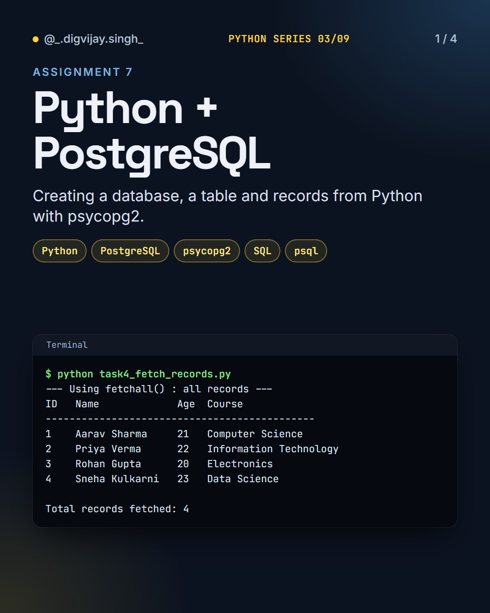
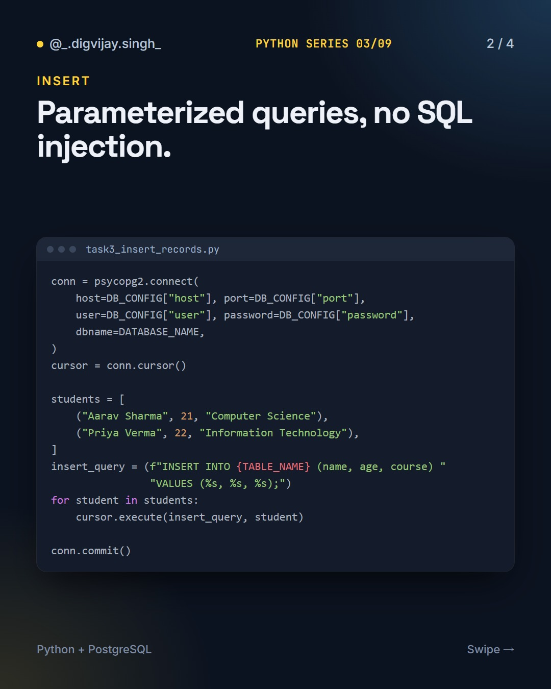
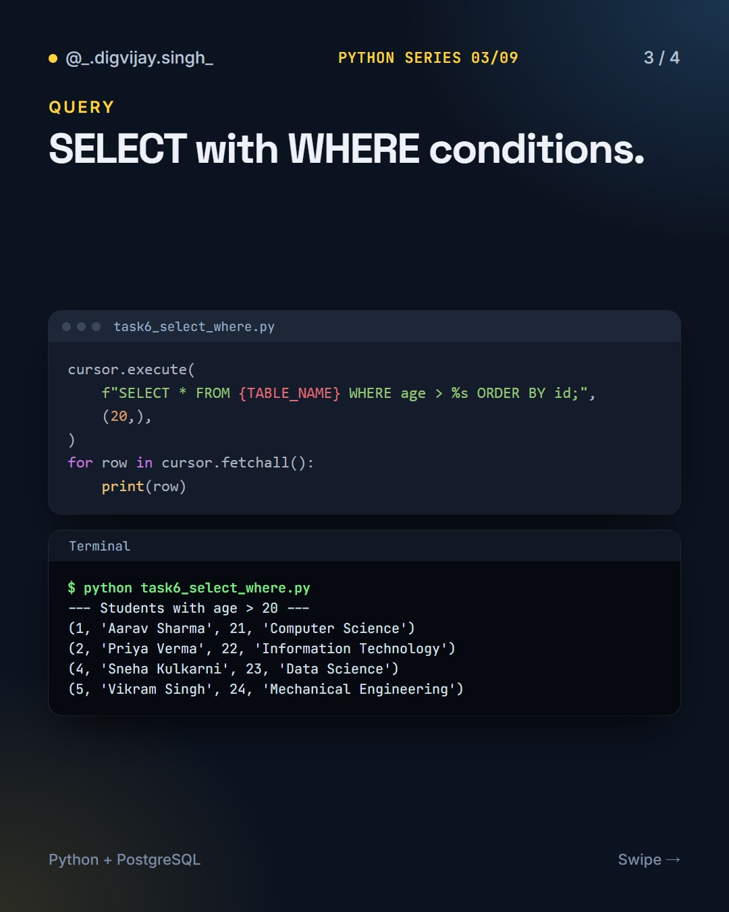
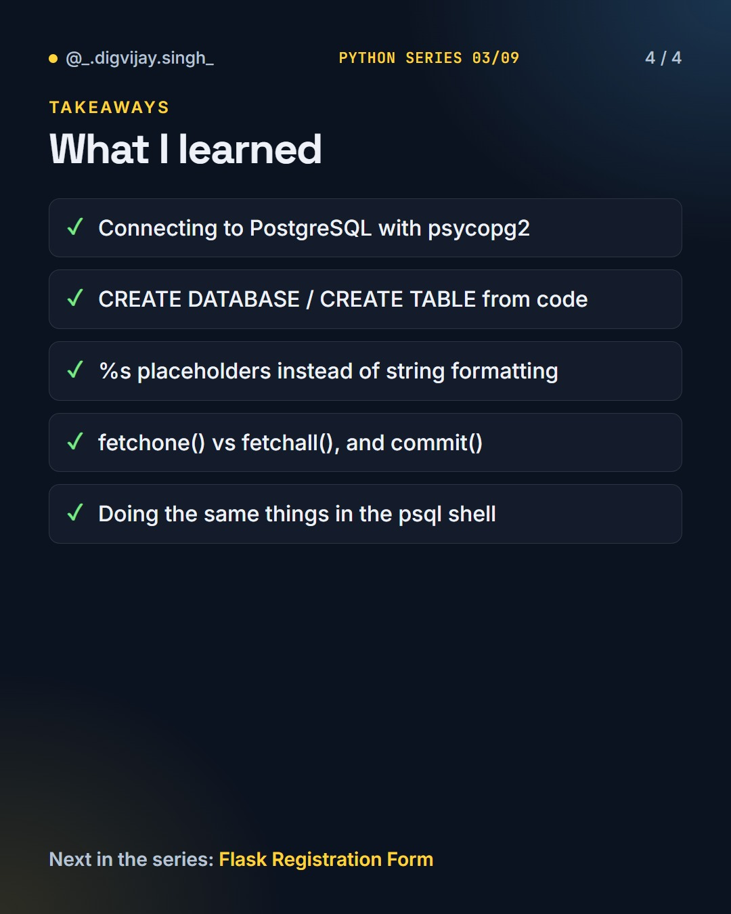

# Python + PostgreSQL

<p align="center"></p>

Creating a database, a table and records in PostgreSQL from Python with psycopg2, using parameterized queries throughout.

Part 3 of 9 in my **Python Series**.

## How to run

You need PostgreSQL running locally. Set your connection details in `db_config.py`, then:

```bash
pip install psycopg2-binary
python task1_connect_and_create_database.py
python task2_create_table.py
python task3_insert_records.py
python task4_fetch_records.py
```

The rest of the tasks (5–7) run the same way. `run_logs/` and `screenshots/` hold the output from my own run.

The original assignment notes are in [NOTES.md](NOTES.md).

## What I learned

- Connecting to PostgreSQL with psycopg2
- `CREATE DATABASE` / `CREATE TABLE` from code
- `%s` placeholders instead of string formatting (no SQL injection)
- `fetchone()` vs `fetchall()`, and `commit()`
- Doing the same things in the `psql` shell

## Slides

<p>



</p>

## The Python Series

1. [Python Basics](https://github.com/digvijay165/python-basics)
2. [Tkinter Calculator](https://github.com/digvijay165/tkinter-calculator)
3. **Python + PostgreSQL**
4. [Flask Registration Form](https://github.com/digvijay165/flask-registration-form)
5. [Django REST Blog API](https://github.com/digvijay165/django-rest-blog-api)
6. [Python Web Scraper](https://github.com/digvijay165/python-web-scraper)
7. [OpenCV Practicals](https://github.com/digvijay165/opencv-practicals)
8. [Selenium Automation](https://github.com/digvijay165/selenium-automation)
9. [Python Chat App](https://github.com/digvijay165/python-chat-app)
